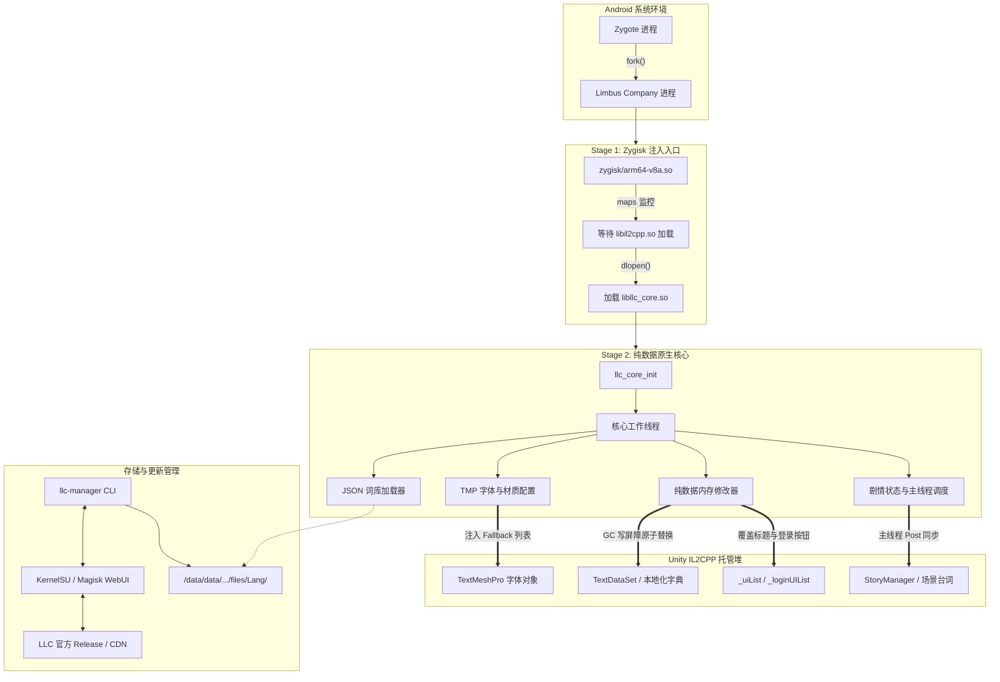

# LLC-Zygisk-Localizer

[](https://developer.android.com)
[](https://github.com/topjohnwu/zygisk-module-sample)
[](#技术架构特性)
[](#免责声明)

《边狱公司》（*Limbus Company*，包名：`com.ProjectMoon.LimbusCompany`）Android 客户端的运行时简体中文本地化模块。

本项目基于 Zygisk 注入机制，在不解包或修改游戏 APK 的前提下，通过定位并修改 Unity IL2CPP 托管堆中的文本对象及 TextMeshPro 字体回退列表，实现游戏运行时的文本汉化。核心逻辑仅操作托管堆数据（Data-Only），不使用针对代码段的 Inline Hook，以避免触发 AppSealing 内存完整性校验。

---

## 技术架构特性

### 1. 纯数据内存修改（Data-Only，无代码段 Hook）
- **避免代码段修改**：不使用针对 Native/IL2CPP 指令的 Inline Hook（如 `A64HookFunction` 等），不在 `.text` 内存段打补丁。AppSealing 包含针对原生代码段的内存完整性校验（违规通常触发错误码 `30010` 强制退出）；纯数据方案在设计上避开了该检测点。
- **托管堆对象遍历与字段替换**：通过 IL2CPP 反射接口获取 `TextDataSet`、`Dictionary<string, string>`、`List<T>` 等内部数据结构的指针与字段偏移，在运行时直接替换字符串指针引用。
- **只读静态观察与指针校验**：在场景切换（如标题页进入大厅）期间，不使用后台线程调用 `il2cpp_runtime_invoke`，改为直接读取静态字段与实例指针，并增加合法地址（`> 0x10000`）与类名校验，降低跨线程/跨场景阶段的访问异常（SIGSEGV）风险。
- **GC 写屏障保护**：修改托管对象引用的字段时，严格调用 IL2CPP 的 GC 写屏障（Write Barrier），维持增量垃圾回收的卡表标记状态。

### 2. 注入核心与汉化资源分离
- **模块体积控制**：Zygisk 模块包体约 1~2 MB，仅包含 Stage 1 注入库、Stage 2 核心库及 WebUI 管理工具。
- **资源独立存放**：汉化文本（JSON）与字体文件存储于游戏私有数据目录，由独立的命令行工具 `llc-manager` 或 WebUI 下载与管理。
- **热更新与版本回滚**：支持基于 SHA-256 校验的资源导入、原子切换（通过 state.json 切换当前包）与回滚，更新语言包无需重启操作系统。

### 3. 数据表与界面文本适配
- **数据表适配**：覆盖技能、被动、状态关键词、E.G.O 饰品、但丁笔记、播报员语音、镜像迷宫主题、章节及关卡等 65+ 张运行期数据表。
- **剧情文本同步**：针对剧情场景，结合台词快照与 `UnitySynchronizationContext.Post` 主线程调度，更新对话正文与地点等显示缓存。
- **标题界面预置覆盖**：通过内置的 `title_overrides.json`，在远程完整词库尚未加载完成前，对标题公告、登录按钮及部分弹窗文案进行覆盖。

### 4. 字体回退（Fallback）注入
- **TMP Fallback 链注入**：加载包含中文字形的 AssetBundle（`tmpchinesefont` / 思源黑体），将其加入 TextMeshPro 字体的 `fallbackFontAssetTable` 中。
- **材质与 Shader 处理**：配置对应字体材质与 Shader Keyword，适配移动端 Vulkan / GLES 渲染管线。
- **字体暂存**：模块安装脚本提供字体文件的持久化备份与恢复路径，避免游戏清理缓存后丢失字体。

### 5. 多语言策略
- 核心工作线程周期性检测游戏设置中的当前语言（`query_game_language`），支持“跟随游戏”、“强制生效”或“停用”策略；当游戏设置为非目标语言时，暂停数据表修改，允许原版语言正常显示。

---

## 系统架构



---

## 运行环境要求

| 项目 | 要求 / 支持范围 |
| --- | --- |
| **操作系统** | Android 10 ~ Android 16+（API Level 26+） |
| **CPU 架构** | `arm64-v8a`（64 位 IL2CPP 运行时） |
| **内存分页** | 兼容 4 KB 与 16 KB 页面（ELF 段已对齐） |
| **Root 方案** | KernelSU / KernelSU-Next / SukiSU / APatch / Magisk |
| **Zygisk 环境** | 启用现代 Zygisk 实现（推荐 Zygisk Next 1.1.0+） |
| **目标游戏** | 《边狱公司》（*Limbus Company*，Google Play 发行版 / 官方 arm64 APK） |

---

## 目录结构

```text
LLC-Zygisk-Localizer/
├── build.ps1                 # 编译、版本推导与安装脚本
├── .gitignore                # Git 忽略配置
├── jni/
│   ├── main.cpp              # Stage 1: Zygisk 过滤与核心加载器
│   ├── zygisk.hpp            # Zygisk C++ API 规范头文件
│   └── core/                 # Stage 2: 纯数据热修核心源码
│       ├── core_main.cpp     # 核心主循环、多语言调度与生命周期监控
│       ├── data_patcher.cpp  # IL2CPP 字典与列表内存热替换
│       ├── font_injector.cpp # TMP 字体 AssetBundle 加载与材质配置
│       ├── story_hook.cpp    # 剧情安全反射与主线程缓存调度
│       ├── json_loader.cpp   # 本地化 JSON 解析与数据装载
│       └── storage.cpp       # 词库存储管理与路径解析
├── module/                   # Magisk / KernelSU 模块模板
│   ├── module.prop           # 模块元数据（由构建脚本动态更新）
│   ├── customize.sh          # 刷机安装脚本与核心暂存同步
│   ├── config/
│   │   ├── title_overrides.json # 标题与登录界面纯数据预置词条
│   │   └── compatibility.json   # 兼容性策略配置
│   ├── bin/llc-manager       # 独立本地化资源管理 CLI
│   └── webroot/              # KernelSU / Magisk WebUI 前端面板
├── tools/                    # 资源打包与状态核验脚本
└── tests/                    # 单元测试与主机模拟测试用例
```

---

## 构建与打包

### 前置要求
1. **Windows PowerShell**（PowerShell 5.1 或 PowerShell 7+）
2. **Android NDK**：推荐 `r26` 及以上版本（脚本支持环境变量或本地 SDK 自动探测，详见 [build.ps1](build.ps1)）
3. **Git**：用于动态版本推导

### 自动化版本机制
打包脚本采用 **Git Revision 动态版本化**：
- **版本号格式**：`v0.4.0-r<Commit数>`（例如第 63 次提交对应 `v0.4.0-r63`，`versionCode=463`）。
- **本地修改标记**：若工作区存在未提交的修改，版本号将自动追加 `-local`（如 `v0.4.0-r63-local`），方便区分调试包与正式提交包。
- **自动同步**：构建时自动将最新版本、作者及信息同步至 [module/module.prop](module/module.prop)。

### 常用构建命令

```powershell
# 1. 完整构建（输出刷机 ZIP 至 dist/ 目录，不触及设备）
.\build.ps1

# 2. 仅编译 Stage 2 核心库（输出 dist/libllc_core.so）
.\build.ps1 -CoreOnly

# 3. 完整构建并通过 ADB 安装（调用 ksud module install）
.\build.ps1 -Install

# 4. 指定特定 ADB 序列号安装
.\build.ps1 -TargetSerial "<设备序列号>" -Install
```

---

## 模块管理与 WebUI

在支持 WebUI 的管理器（如 KernelSU / SukiSU）中打开本模块卡片，或通过 Root Shell 执行 `llc-manager`：

### WebUI 功能
- **状态查看**：显示当前磁盘汉化版本、游戏进程加载版本与词条匹配概况。
- **在线更新与切换**：检查官方 GitHub Release / 镜像源，支持后台下载校验、原子切换与上一版本回滚。
- **字体与语言策略**：选择语言跟随模式，管理自定义字体暂存。
- **本地代理设置**：支持为资源下载设置专用 HTTP/SOCKS 代理（如 `127.0.0.1:7890`）。

### 原生 CLI 常用命令
```sh
# 检查更新（输出 JSON 报告）
/data/adb/modules/llc_zygisk/bin/llc-manager check

# 查看当前资源与运行进程状态
/data/adb/modules/llc_zygisk/bin/llc-manager status --json

# 激活新下载的候选版本
/data/adb/modules/llc_zygisk/bin/llc-manager activate <版本号>

# 回滚到上一汉化包
/data/adb/modules/llc_zygisk/bin/llc-manager rollback
```

---

## 运行排错与诊断

当需要收集日志或定位特定文本匹配情况时，可使用以下诊断方式：

### 1. ADB 实时日志过滤
```powershell
adb logcat -s LLC_Zygisk LLC_CORE
```
- `LLC_Zygisk`：Stage 1 注入、进程匹配与 Stage 2 加载日志。
- `LLC_CORE`：字体注入、数据表遍历、剧情主线程同步与运行日志。

### 2. 触发运行时内存转储（Dump）
在游戏运行状态下，通过向外部私有目录写入触发文件导出状态：
```powershell
# 导出当前已同步的全部文本表条目至 llc_text_dump.txt
adb shell "su -c 'touch /sdcard/Android/data/com.ProjectMoon.LimbusCompany/files/llc_dump'"

# 导出当前字体回退列表与材质状态至 llc_font_dump.txt
adb shell "su -c 'touch /sdcard/Android/data/com.ProjectMoon.LimbusCompany/files/llc_font'"

# 导出当前剧情活动场景与文本检查报告至 llc_story_state.json
adb shell "su -c 'touch /sdcard/Android/data/com.ProjectMoon.LimbusCompany/files/llc_story_check'"
```

---

## 分支模型与提交规范

- **分支模型**：
  - `master`：主分支，存放经过实机验证的稳定提交与发布版本。
  - `dev`：日常开发分支，用于新特性开发与问题修复。
- **提交规范**：
  - 遵循英文 [Conventional Commits](https://www.conventionalcommits.org/) 格式，例如：
    - `feat(patcher): add in-place dictionary synchronization`
    - `fix(core): prevent scene transition SIGSEGV by removing background invoke`
    - `chore(build): synchronize module metadata and automate revision versioning`

---

## 作者与致谢

- **[Linoleic](https://github.com/Linoleic)**：Zygisk 注入流程、IL2CPP 纯数据内存热修实现、Android 跨场景防崩溃重构、WebUI 控制面板与自动化构建体系。
- **[LLC Team (LimbusLocalize)](https://github.com/LocalizeLimbusCompany/LocalizeLimbusCompany)**：上游剧情、UI、人格与技能等本地化翻译数据源。

---

## 免责声明

1. 本项目作为开源技术研究，仅供逆向工程与 Android 原生注入技术探讨使用。
2. 本项目严禁用于商业用途。
3. 《边狱公司》（*Limbus Company*）及其所有美术素材、游戏文本和知识产权均归 **Project Moon** 所有。
4. 使用本模块所产生的一切后果由使用者自行承担。
