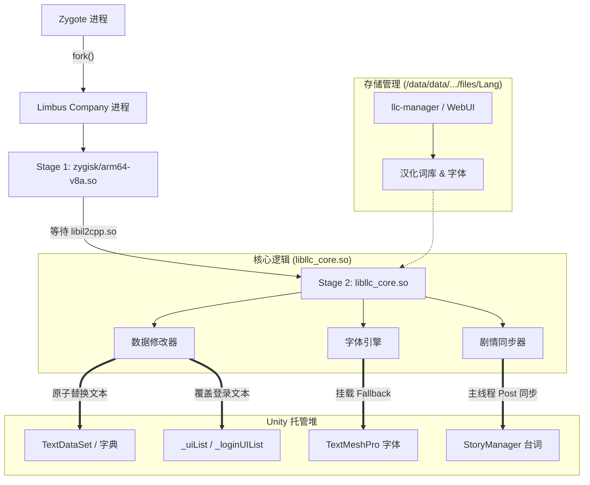

# LLC-Zygisk-Localizer

[](https://developer.android.com)
[](LICENSE)

《边狱公司》（*Limbus Company*，包名：`com.ProjectMoon.LimbusCompany`）Android 客户端的运行时汉化 Zygisk 模块。

采用纯数据替换（Data-Only）方案：基于 Zygisk 注入，通过 IL2CPP 反射直接定位并替换托管堆中的文本对象与 TextMeshPro 字体回退链，不在 `.text` 代码段执行任何 Inline Hook，避开 AppSealing 内存完整性校验（错误码 30010）。

---

## 核心特性

- **纯数据内存替换**：仅读写 IL2CPP 托管堆中的 `TextDataSet`、字典及列表指针，不修改任何指令代码，避开反作弊内存校验。
- **按表替换与审计**：已接入 71 张运行时文本表，并支持剧情对话与标题界面登录按钮；按实际加载的数据审计缺译和结构问题，不将表数量视为全游戏覆盖率。
- **文本结构发现**：诊断页可只读建立结构基线，比较候选容器、文本类及其字段的新增、消失和变化。建立基线后，在状态刷新检测到游戏构建或适配清单变化且数据加载完成时复查；候选项不会自动接入替换，也不直接计为缺译。
- **动态字体注入**：加载中文字体 AssetBundle 并挂载至 TextMeshPro 字体回退列表。
- **热更新与资源分离**：词库与字体存放在应用私有目录，支持通过 WebUI 或命令行工具 `llc-manager` 在线更新、切换与回滚，无需重启系统。
- **多语言策略**：支持跟随游戏语言设置，在非目标语言下自动暂停替换。

## 当前开发状态

WebUI 使用独立的简版本号 **v4**，与模块版本分开维护。总览提供推荐操作；汉化包、设置、诊断页可自由切换。下载后需确认启用，切换汉化包后完全退出并重开游戏即可生效，无需重启设备。

2026-11-05 已在 Xiaomi Pad 6S Pro 12.4 测试“新游戏 + 旧汉化包”：通过 Google Play 更新至 **1.118.1 / 构建号 488**，保留汉化包 **2026103002**，完成资源下载后两次冷启动进入主页，71 张同步表结束等待，未观察到写入失败或源映射不匹配。

当前仍有局部缺口：对照历史记录新增 13 项表内缺译（总计 38 项，包含跨表重复 ID），以及饰品 **9226** 新增能力 **92262** 的子项缺译。能力集合未对齐时，模块保留该饰品完整效果描述的原文，防止旧译文遗漏新增效果；其他已匹配内容继续汉化。首页独立展示运行健康状态、缺译与保留原文的数量。自适应策略放行、文件完整性通过、运行中已加载属于不同证据，均不代表译文语义最新或全游戏适配完成。本轮未完成战斗和剧情的完整回归，详细变更与限制见 [更新日志](CHANGELOG.md)。

发现未来新文本类时，可进入「诊断 → 文本结构发现与差异 → 检查文本结构」，或以 root 执行 `/data/adb/modules/llc_zygisk/bin/llc-manager discover --json`。首次只建立基线，后续保留上一份基线供比较；失败或不完整采集不覆盖成功结果。范围限于 `TextDataSet` 的已知字段或类型包含 `TextData` 的候选字段，以及同程序集内具有实例字符串字段的 `TextData_` 类，任意命名的新类、其他程序集和渲染缓存仍可能漏检。游戏后台暂停时可能无法检查，需回到游戏使其恢复运行。现有版本实机得到 77 个候选容器、58 个候选文本类和 4 个待核对容器，待核对项不等同于确认缺译。

随后只读核对确认两处尚未接入的缺口：`_story` 有 1 条已提供译文但仍保留英文的文本；`_illustGetConditionText` 有 389 条人格/E.G.O 插画获取条件，能找到非空中文映射但尚未应用。它们尚未纳入 71 张同步表，不能把已接入表的缺译计数视为全游戏总量。另外两个候选（抽取公告、BGM 分类）在本次主页采样中运行表和对应汉化文件均为空。候选核对可使用 `tools/check_content.py --serial <设备> --table <候选表> --audit-candidate --output <报告路径>`；报告成功仅表示完成只读采集，不能作为汉化通过依据。

---

## 系统架构



---

## 运行环境

| 项目 | 要求 |
| :--- | :--- |
| **操作系统** | Android 10 ~ 16+（API Level 26+） |
| **CPU 架构** | `arm64-v8a`（64 位 IL2CPP 运行时） |
| **内存分页** | 兼容 4 KB 与 16 KB 页面对齐 |
| **Root 方案** | KernelSU / KernelSU-Next / SukiSU / APatch / Magisk |
| **Zygisk 环境** | 启用现代 Zygisk 实现（推荐 Zygisk Next 1.1.0+） |

---

## 目录结构

```text
LLC-Zygisk-Localizer/
├── build.ps1                 # 构建与安装脚本
├── BUILD.md                  # 构建与测试文档
├── jni/
│   ├── main.cpp              # Stage 1: Zygisk 注入入口
│   ├── zygisk.hpp            # Zygisk API 头文件
│   └── core/                 # Stage 2: 纯数据核心源码
│       ├── core_main.cpp     # 核心主循环与生命周期管理
│       ├── data_patcher.cpp  # 数据表与字典内存替换
│       ├── font_injector.cpp # TMP 字体与标题文本替换
│       ├── story_hook.cpp    # 剧情反射与主线程缓存同步
│       ├── json_loader.cpp   # 本地化 JSON 解析与加载
│       └── storage.cpp       # 资源路径与状态管理
├── module/                   # Magisk / KernelSU 模块模板
│   ├── module.prop           # 模块元数据模板
│   ├── customize.sh          # 刷机安装脚本
│   ├── config/               # 静态覆盖与兼容性配置
│   ├── bin/llc-manager       # 独立本地化资源管理 CLI
│   └── webroot/              # WebUI 管理面板前端
├── tools/                    # 资源打包与辅助工具
└── tests/                    # 测试用例
```

---

## 构建与打包

详细构建、安装与测试流程见 [BUILD.md](BUILD.md)。

快速命令：

```powershell
# 构建刷机包至 dist/
.\build.ps1

# 构建并通过 ADB + ksud 安装到设备
.\build.ps1 -Install
```

发布版本和升级码由 `module/module.prop` 的 `version`、`versionCode` 显式维护；发布新安装包时需递增升级码，绝不从 Git 提交数推算。包名显示为 `vMAJOR.MINOR.PATCH-r<Git提交数>`，工作区有未提交改动时追加 `-local`；提交数仅作为人类可读标签，不影响升级判断。构建仍会将完整 Git 提交号、本地修改标记和 UTC 构建时间写入核心与管理器供诊断。WebUI 分为总览、汉化包、设置和诊断四个标签页，可自由切换；总览根据当前状态提供一个推荐操作，汉化包页可独立检查、下载、启用或恢复资源，设置草稿在切换标签页后保留。页面从系统包管理器读取已安装游戏版本与构建号（游戏未运行时也可读取，失败时显示未取得）。游戏版本指安装包版本，不代表游戏内热更新资源版本，也不据此推断汉化完整性。诊断区分别显示模块版本、管理器构建、当前游戏进程的核心构建，以及磁盘和运行中的汉化资源版本。单独更新核心后，管理器与运行核心的构建标识可以不同。

---

## 模块管理

模块提供 WebUI 管理面板（可在 KernelSU / SukiSU 等管理器中直接打开）与命令行工具 `llc-manager`：

```sh
# 检查更新
/data/adb/modules/llc_zygisk/bin/llc-manager check

# 查看当前资源与运行进程状态
/data/adb/modules/llc_zygisk/bin/llc-manager status --json

# 下载并校验候选包
/data/adb/modules/llc_zygisk/bin/llc-manager download

# 激活当前候选包（可追加候选 key 绑定目标）
/data/adb/modules/llc_zygisk/bin/llc-manager activate

# 回滚到上一版本
/data/adb/modules/llc_zygisk/bin/llc-manager rollback
```

全新安装且没有旧汉化包版本标记时，可直接激活已校验候选包；首次激活没有上一包可回滚。已有旧汉化包时，先执行 `llc-manager import-current` 建立回滚基线，再激活候选。激活后重开游戏进程生效。

下载优先使用系统 curl；设备缺少 curl 时使用模块内置的 Android HTTPS 辅助程序，沿用系统证书校验。模块代理设置支持本地 HTTP 代理，网络不可直达 GitHub 时仍需配置可用代理或镜像。WebUI 展示候选来源、归档大小、SHA-256、校验时间与激活状态，并区分 DNS、连接、证书、超时和完整性错误；下载失败时保留原候选。

---

## 常见问题

**Q: 使用本模块会导致封号或闪退（30010）吗？**  
A: 本模块使用未修改的原版 APK，且不在 `.text` 代码段执行任何 Inline Hook，避开了 AppSealing 的主要内存检测点（错误码 30010）。但任何第三方运行时修改在官方用户协议中均属非许可行为，请使用者知悉并自行承担风险。

**Q: 汉化资源为什么存放在应用私有目录，而不是 `/data/adb`？**  
A: 游戏进程运行于普通应用沙箱（`untrusted_app`），内核在强制模式下禁止其访问 `/data/adb`；同时反作弊会扫描 `/proc/self/fd`，检测到 root 敏感路径会触发报警。存放在私有目录（`files/Lang/`）安全且合规。

**Q: 游戏更新后会失效或崩溃吗？**  
A: 日常小补丁和文本热更不影响模块运作。若游戏大版本更新改变了关键数据结构或字段偏移，可能需重新适配并编译核心库。

**Q: 为什么标题界面有时文本未替换，进入大厅后才正常？**  
A: 游戏内大部分数据表由 Unity 异步加载，核心工作线程在后台监听，加载完成后自动触发替换。标题界面的常用登录按钮已通过内置映射及预置配置实现即时覆盖。

---

## 排错与诊断

### 实时日志
```powershell
adb logcat -s LLC_Zygisk LLC_CORE
```
- `LLC_Zygisk`：注入与核心库加载日志。
- `LLC_CORE`：字体挂载、数据表替换及剧情同步日志。

缺译和结构问题使用 `[LLC-DIAG]` 汇总：按表和原因报告当前观察数量、最多 3 个样例，以及自上次输出以来被抑制的重复提交次数。相同快照不重复打印；变化后的同组汇总最多每 30 秒输出一次，主循环会补发待输出变化。只有完整遍历才能判定旧告警已恢复，恢复后再次出现会重新报告。热重载资源时重置去重状态。日志缓存最多保存 512 组，达到上限时明确提示；日志数量与样例限制不影响状态报告中的详细审计计数，也不代表全游戏缺译总量。UI 映射未命中使用 `unmapped_ui_key`，与已验证翻译源中缺失条目的 `missing_local` 分开报告。

管理器的热重载标记路径按优先级回退，只发布一个请求。核心兼容旧版同时留下的多个标记，在同一轮全部消费后只执行一次重载，避免重复加载整包和重复输出诊断。

### 运行时内存转储（Dump）
游戏运行状态下向私有目录写入触发文件可导出状态：
```powershell
# 导出已同步文本表至 llc_text_dump.txt
adb shell "su -c 'touch /sdcard/Android/data/com.ProjectMoon.LimbusCompany/files/llc_dump'"

# 导出当前字体回退列表至 llc_font_dump.txt
adb shell "su -c 'touch /sdcard/Android/data/com.ProjectMoon.LimbusCompany/files/llc_font'"

# 导出剧情状态报告至 llc_story_state.json
adb shell "su -c 'touch /sdcard/Android/data/com.ProjectMoon.LimbusCompany/files/llc_story_check'"
```

---

## 致谢

- **[LimbusLocalize (LLC Team)](https://github.com/LocalizeLimbusCompany/LocalizeLimbusCompany)**：上游中文本地化翻译数据源。

---

## 免责声明

1. 本项目仅供逆向工程与 Android 原生注入技术学习研究使用。
2. 《边狱公司》（*Limbus Company*）及其素材知识产权归 **Project Moon** 所有，本项目与 Project Moon 无任何关联。
3. 使用本模块所产生的一切后果由使用者自行承担。
