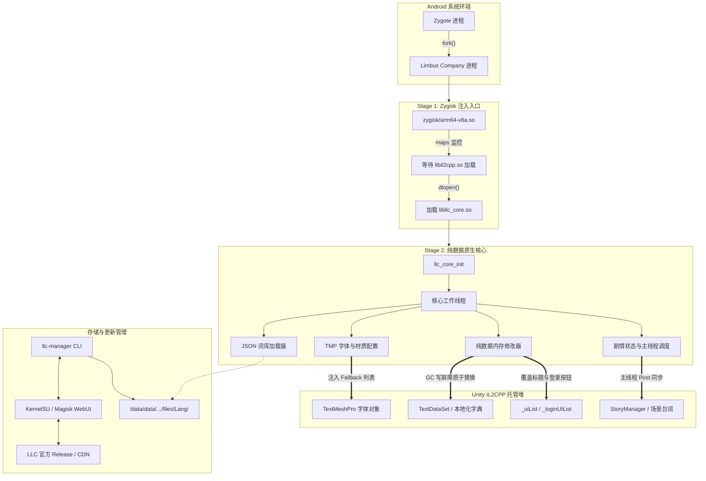

# LLC-Zygisk-Localizer

[](https://developer.android.com)
[](https://github.com/topjohnwu/zygisk-module-sample)
[](#技术架构特性)
[](LICENSE)

《边狱公司》（*Limbus Company*，包名：`com.ProjectMoon.LimbusCompany`）Android 客户端的运行时简体中文本地化模块。

本项目基于 Zygisk 注入机制，在不解包或修改游戏 APK 的前提下，通过定位并修改 Unity IL2CPP 托管堆中的文本对象及 TextMeshPro 字体回退列表，实现游戏运行时的文本汉化。核心逻辑仅操作托管堆数据（Data-Only），不使用针对代码段的 Inline Hook，以避免触发 AppSealing 内存完整性校验。

---

## 技术方案对比

| 方案类型 | 核心实现机制 | 优点 | 局限性与潜在风险 |
| :--- | :--- | :--- | :--- |
| **修改重签名 APK** | 解包 APK 替换内部资源或 DLL，重新签名打包 | 安装即可使用，无需设备 Root 权限 | 破坏原版签名，AppSealing 极易检测到签名异常；每次游戏更新必须重新下载数 GB 全量包；封号风险较高。 |
| **应用容器 / 虚拟机** | 在虚拟空间（如分身/免Root虚拟机）内拦截重定向文件 I/O | 免 Root 环境；不直接修改原版 APK 文件 | 虚拟环境特征明显，易被反作弊识别；额外的中间层导致帧率损耗与发热增加；对 Android 14+ 兼容性较差。 |
| **传统 Inline Hook 模块** | 通过 Zygisk 注入，使用 `A64HookFunction` / Dobby 等对 IL2CPP 原生函数挂钩 | 逻辑拦截灵活，开发门槛相对较低 | **直接修改 `.text` 代码段指令**，必然触发 AppSealing 内存完整性校验（错误码 `30010` 强制退出）；跨场景时并发崩溃率高。 |
| **纯数据 Zygisk 方案<br>(本项目)** | Zygisk 注入后，仅通过反射安全遍历与替换 Unity 托管堆中的数据结构（`TextDataSet`、字典、TMP Fallback 链） | **原版 APK 签名完好**；**0 代码段修改**（避开 AppSealing 30010 检测）；原生 Vulkan/GLES 零额外损耗；支持免重启热更 | 依赖设备具备 Root 与 Zygisk 环境；若游戏底层数据类字段发生重大重构需适配更新。 |

---

## 技术架构特性

### 1. 纯数据内存修改（Data-Only，无代码段 Hook）
- **避免代码段修改**：不使用针对 Native/IL2CPP 指令的 Inline Hook（如 `A64HookFunction` 等），不在 `.text` 内存段打补丁。AppSealing 包含针对原生代码段的内存完整性校验（违规通常触发错误码 `30010` 强制退出）；纯数据方案在设计上避开了该检测点。
- **托管堆对象遍历与字段替换**：通过 IL2CPP 反射接口获取 `TextDataSet`、`Dictionary<string, string>`、`List<T>` 等内部数据结构的指针与字段偏移，在运行时直接替换字符串指针引用。
- **只读静态观察与指针校验**：在场景切换（如标题页进入大厅）期间，不使用后台线程调用 `il2cpp_runtime_invoke`，改为直接读取静态字段与实例指针，并增加合法地址（`> 0x10000`）与类名校验，降低跨线程/跨场景阶段的访问异常（SIGSEGV）风险。
- **GC 写屏障保护**：修改托管对象引用的字段时，严格调用 IL2CPP 的 GC 写屏障（Write Barrier），维持增量垃圾回收的卡表标记状态。

### 2. 注入核心与汉化资源分离
- **模块体积控制**：Zygisk 模块包体约 1~2 MB，仅包含 Stage 1 注入库、Stage 2 核心库及 WebUI 管理工具。
- **资源独立存放**：汉化文本（JSON）与字体文件存储于游戏私有数据目录，由独立的命令行工具 `llc-manager` 或 WebUI 下载与管理。
- **热更新与版本回滚**：支持基于 SHA-256 校验的资源导入、原子切换（通过 state.json 切换当前包）与回滚，更新语言包无需重启操作系统。

### 3. 数据表与界面文本适配
- **数据表适配**：覆盖技能、被动、状态关键词、E.G.O 饰品、但丁笔记、播报员语音、镜像迷宫主题、章节及关卡等 65+ 张运行期数据表。
- **剧情文本同步**：针对剧情场景，结合台词快照与 `UnitySynchronizationContext.Post` 主线程调度，更新对话正文与地点等显示缓存。
- **静态界面文本预置覆盖**：标题界面的常用登录与系统按钮（Google、Guest、Apple、Steam、切换账号等）由 C++ 引擎内置自适应映射至词库 `LoginUIText.json` 标准键；少数未分配多语言 Key 的纯静态文本通过内置的 `static_overrides.json` 进行覆盖补齐。

### 4. 字体回退（Fallback）注入
- **TMP Fallback 链注入**：加载包含中文字形的 AssetBundle（`tmpchinesefont` / 思源黑体），将其加入 TextMeshPro 字体的 `fallbackFontAssetTable` 中。
- **材质与 Shader 处理**：配置对应字体材质与 Shader Keyword，适配移动端 Vulkan / GLES 渲染管线。
- **字体暂存**：模块安装脚本提供字体文件的持久化备份与恢复路径，避免游戏清理缓存后丢失字体。

### 5. 多语言策略
- 核心工作线程周期性检测游戏设置中的当前语言（`query_game_language`），支持“跟随游戏”、“强制生效”或“停用”策略；当游戏设置为非目标语言时，暂停数据表修改，允许原版语言正常显示。

---

## 系统架构



---

## 运行环境要求

| 项目 | 要求 / 支持范围 |
| --- | --- |
| **操作系统** | Android 10 ~ Android 16+（API Level 26+） |
| **CPU 架构** | `arm64-v8a`（64 位 IL2CPP 运行时） |
| **内存分页** | 兼容 4 KB 与 16 KB 页面（ELF 段已对齐） |
| **Root 方案** | KernelSU / KernelSU-Next / SukiSU / APatch / Magisk |
| **Zygisk 环境** | 启用现代 Zygisk 实现（推荐 Zygisk Next 1.1.0+） |
| **目标游戏** | 《边狱公司》（*Limbus Company*，Google Play 发行版 / 官方 arm64 APK） |

---

## 目录结构

```text
LLC-Zygisk-Localizer/
├── build.ps1                 # 编译、版本推导与安装脚本
├── BUILD.md                  # 构建、安装与测试说明
├── .gitignore                # Git 忽略配置
├── jni/
│   ├── main.cpp              # Stage 1: Zygisk 过滤与核心加载器
│   ├── zygisk.hpp            # Zygisk C++ API 规范头文件
│   └── core/                 # Stage 2: 纯数据热修核心源码
│       ├── core_main.cpp     # 核心主循环、多语言调度与生命周期监控
│       ├── data_patcher.cpp  # IL2CPP 字典与列表内存热替换
│       ├── font_injector.cpp # TMP 字体 AssetBundle 加载与材质配置
│       ├── story_hook.cpp    # 剧情安全反射与主线程缓存调度
│       ├── json_loader.cpp   # 本地化 JSON 解析与数据装载
│       └── storage.cpp       # 词库存储管理与路径解析
├── module/                   # Magisk / KernelSU 模块模板
│   ├── module.prop           # 模块元数据模板（版本号由构建脚本在暂存副本中写入）
│   ├── customize.sh          # 刷机安装脚本与核心暂存同步
│   ├── config/
│   │   ├── static_overrides.json # 静态未映射文本纯数据预置词条
│   │   └── compatibility.json   # 兼容性策略配置
│   ├── bin/llc-manager       # 独立本地化资源管理 CLI
│   └── webroot/              # KernelSU / Magisk WebUI 前端面板
├── tools/                    # 资源打包与状态核验脚本
└── tests/                    # 单元测试与主机模拟测试用例
```

---

## 构建与打包

构建、安装与测试方法见 [BUILD.md](BUILD.md)。快速开始：

```powershell
.\build.ps1            # 构建并打包至 dist/
.\build.ps1 -Install   # 构建并通过 ADB + ksud 安装
```

---

## 模块管理与 WebUI

在支持 WebUI 的管理器（如 KernelSU / SukiSU）中打开本模块卡片，或通过 Root Shell 执行 `llc-manager`：

### WebUI 功能
- **状态查看**：显示当前磁盘汉化版本、游戏进程加载版本与词条匹配概况。
- **在线更新与切换**：检查官方 GitHub Release / 镜像源，支持后台下载校验、原子切换与上一版本回滚。
- **字体与语言策略**：选择语言跟随模式，管理自定义字体暂存。
- **本地代理设置**：支持为资源下载设置专用 HTTP/SOCKS 代理（如 `127.0.0.1:7890`）。

### 原生 CLI 常用命令
```sh
# 检查更新（输出 JSON 报告）
/data/adb/modules/llc_zygisk/bin/llc-manager check

# 查看当前资源与运行进程状态
/data/adb/modules/llc_zygisk/bin/llc-manager status --json

# 激活新下载的候选版本
/data/adb/modules/llc_zygisk/bin/llc-manager activate <版本号>

# 回滚到上一汉化包
/data/adb/modules/llc_zygisk/bin/llc-manager rollback
```

---

## 常见问题（FAQ）

#### Q1: 使用本模块是否存在账号安全或封禁风险？
**A**: 
- **客户端防篡改检测**：传统封禁或闪退（如错误码 `30010`）通常由 AppSealing 触发，诱因是 APK 签名被改动、检测到虚拟容器环境，或内存 `.text` 代码段指令被 Inline Hook 篡改。本模块使用原版未修改 APK，且全程采用纯数据（Data-Only）方案，避开了上述客户端已知检测点。
- **客观风险提示**：任何针对游戏运行期的第三方修改在官方用户协议（ToS）中均属于非许可行为。尽管本模块在架构上尽最大可能避免了触发反作弊系统，但无法对游戏厂商未来的服务端行为分析或反作弊规则调整做绝对担保，请使用者知悉并自行承担使用风险。

#### Q2: 汉化文本和字体为什么不保存在 `/data/adb` 模块目录下？
**A**:
- **SELinux 隔离**：游戏进程运行于普通应用沙箱（`untrusted_app` 域），在系统强制模式（Enforcing）下，内核直接禁止游戏进程访问或遍历 `/data/adb` 路径。
- **避免反作弊扫描**：AppSealing 会监控游戏进程打开的文件描述符（`/proc/self/fd`）。如果检测到句柄指向 `/data/adb` 等 Root 敏感路径，会触发异常告警。因此资源保存在游戏合法的私有数据目录（`files/Lang/`）是最稳妥的做法。

#### Q3: 游戏更新后汉化会失效或崩溃吗？
**A**:
- **日常维护与小补丁**：通常仅更新文本与资源，不改动游戏内部核心类（如 `TextDataSet`）的字段结构，本模块可无缝继续生效。
- **大版本换包更新**：若底层 IL2CPP 数据结构或关键字段偏移发生变化，可能需要适配并编译新版本的 `libllc_core.so`。可通过 WebUI 的状态看板观察数据表匹配命中率。

#### Q4: 为什么进入游戏后标题界面的登录按钮能显示中文，但进入大厅后偶尔有部分文本延迟？
**A**:
- **标题登录**：常用登录与账号按钮由 C++ 引擎自适应绑定至 `LoginUIText`，极少数纯静态文本通过 `static_overrides.json` 即时注入，确保首次启动即可看懂登录入口。
- **游戏数据表**：Unity 内部的大多数本地化表（如人格技能、饰品）是进入大厅后异步加载填充的。核心工作线程会在后台安全监听，一旦检测到数据表加载完毕，便会自动触发原子替换。

---

## 运行排错与诊断

当需要收集日志或定位特定文本匹配情况时，可使用以下诊断方式：

### 1. ADB 实时日志过滤
```powershell
adb logcat -s LLC_Zygisk LLC_CORE
```
- `LLC_Zygisk`：Stage 1 注入、进程匹配与 Stage 2 加载日志。
- `LLC_CORE`：字体注入、数据表遍历、剧情主线程同步与运行日志。

### 2. 触发运行时内存转储（Dump）
在游戏运行状态下，通过向外部私有目录写入触发文件导出状态：
```powershell
# 导出当前已同步的全部文本表条目至 llc_text_dump.txt
adb shell "su -c 'touch /sdcard/Android/data/com.ProjectMoon.LimbusCompany/files/llc_dump'"

# 导出当前字体回退列表与材质状态至 llc_font_dump.txt
adb shell "su -c 'touch /sdcard/Android/data/com.ProjectMoon.LimbusCompany/files/llc_font'"

# 导出当前剧情活动场景与文本检查报告至 llc_story_state.json
adb shell "su -c 'touch /sdcard/Android/data/com.ProjectMoon.LimbusCompany/files/llc_story_check'"
```

---

## 分支模型与提交规范

- **分支模型**：
  - `master`：主分支，存放经过实机验证的稳定提交与发布版本。
  - `dev`：日常开发分支，用于新特性开发与问题修复。
- **提交规范**：
  - 遵循英文 [Conventional Commits](https://www.conventionalcommits.org/) 格式，例如：
    - `feat(patcher): add in-place dictionary synchronization`
    - `fix(core): prevent scene transition SIGSEGV by removing background invoke`
    - `chore(build): synchronize module metadata and automate revision versioning`

---

## 致谢

- **[LLC Team (LimbusLocalize)](https://github.com/LocalizeLimbusCompany/LocalizeLimbusCompany)**：上游剧情、UI、人格与技能等本地化翻译数据源。

---

## 免责声明

1. 本项目作为开源技术研究，仅供逆向工程与 Android 原生注入技术探讨使用。
2. 本仓库代码以 [MIT License](LICENSE) 发布，第三方组件见 [THIRD_PARTY_NOTICES.md](THIRD_PARTY_NOTICES.md)；仓库不包含汉化词库，词库由用户运行时从上游下载，受其自身许可与条款约束。
3. 《边狱公司》（*Limbus Company*）及其所有美术素材、游戏文本和知识产权均归 **Project Moon** 所有；本项目为非官方项目，与 Project Moon 无任何关联，也未获其认可。
4. 使用本模块所产生的一切后果由使用者自行承担。
