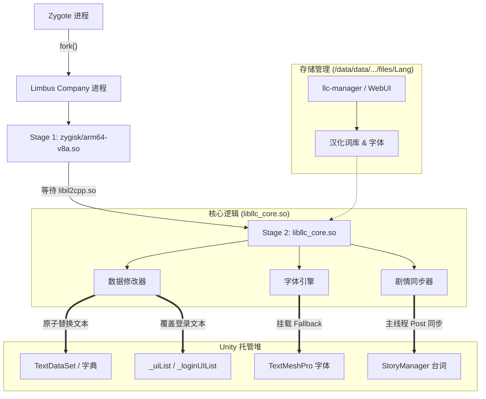

# LLC-Zygisk-Localizer

[](https://developer.android.com)
[](LICENSE)

《边狱公司》（*Limbus Company*，包名：`com.ProjectMoon.LimbusCompany`）Android 客户端的运行时汉化 Zygisk 模块。

采用纯数据替换（Data-Only）方案：基于 Zygisk 注入，通过 IL2CPP 反射直接定位并替换托管堆中的文本对象与 TextMeshPro 字体回退链，不在 `.text` 代码段执行任何 Inline Hook，避开 AppSealing 内存完整性校验（错误码 30010）。

---

## 核心特性

- **纯数据内存替换**：仅读写 IL2CPP 托管堆中的 `TextDataSet`、字典及列表指针，不修改任何指令代码，避开反作弊内存校验。
- **绝大部分文本覆盖**：覆盖 65+ 张数据表（技能、关键词、饰品等）、剧情对话与标题界面登录按钮。
- **动态字体注入**：加载中文字体 AssetBundle 并挂载至 TextMeshPro 字体回退列表。
- **热更新与资源分离**：词库与字体存放在应用私有目录，支持通过 WebUI 或命令行工具 `llc-manager` 在线更新、切换与回滚，无需重启系统。
- **多语言策略**：支持跟随游戏语言设置，在非目标语言下自动暂停替换。

---

## 系统架构



---

## 运行环境

| 项目 | 要求 |
| :--- | :--- |
| **操作系统** | Android 10 ~ 16+（API Level 26+） |
| **CPU 架构** | `arm64-v8a`（64 位 IL2CPP 运行时） |
| **内存分页** | 兼容 4 KB 与 16 KB 页面对齐 |
| **Root 方案** | KernelSU / KernelSU-Next / SukiSU / APatch / Magisk |
| **Zygisk 环境** | 启用现代 Zygisk 实现（推荐 Zygisk Next 1.1.0+） |

---

## 目录结构

```text
LLC-Zygisk-Localizer/
├── build.ps1                 # 构建与安装脚本
├── BUILD.md                  # 构建与测试文档
├── jni/
│   ├── main.cpp              # Stage 1: Zygisk 注入入口
│   ├── zygisk.hpp            # Zygisk API 头文件
│   └── core/                 # Stage 2: 纯数据核心源码
│       ├── core_main.cpp     # 核心主循环与生命周期管理
│       ├── data_patcher.cpp  # 数据表与字典内存替换
│       ├── font_injector.cpp # TMP 字体与标题文本替换
│       ├── story_hook.cpp    # 剧情反射与主线程缓存同步
│       ├── json_loader.cpp   # 本地化 JSON 解析与加载
│       └── storage.cpp       # 资源路径与状态管理
├── module/                   # Magisk / KernelSU 模块模板
│   ├── module.prop           # 模块元数据模板
│   ├── customize.sh          # 刷机安装脚本
│   ├── config/               # 静态覆盖与兼容性配置
│   ├── bin/llc-manager       # 独立本地化资源管理 CLI
│   └── webroot/              # WebUI 管理面板前端
├── tools/                    # 资源打包与辅助工具
└── tests/                    # 测试用例
```

---

## 构建与打包

详细构建、安装与测试流程见 [BUILD.md](BUILD.md)。

快速命令：

```powershell
# 构建刷机包至 dist/
.\build.ps1

# 构建并通过 ADB + ksud 安装到设备
.\build.ps1 -Install
```

---

## 模块管理

模块提供 WebUI 管理面板（可在 KernelSU / SukiSU 等管理器中直接打开）与命令行工具 `llc-manager`：

```sh
# 检查更新
/data/adb/modules/llc_zygisk/bin/llc-manager check

# 查看当前资源与运行进程状态
/data/adb/modules/llc_zygisk/bin/llc-manager status --json

# 激活指定版本
/data/adb/modules/llc_zygisk/bin/llc-manager activate <版本号>

# 回滚到上一版本
/data/adb/modules/llc_zygisk/bin/llc-manager rollback
```

---

## 常见问题

**Q: 使用本模块会导致封号或闪退（30010）吗？**  
A: 本模块使用未修改的原版 APK，且不在 `.text` 代码段执行任何 Inline Hook，避开了 AppSealing 的主要内存检测点（错误码 30010）。但任何第三方运行时修改在官方用户协议中均属非许可行为，请使用者知悉并自行承担风险。

**Q: 汉化资源为什么存放在应用私有目录，而不是 `/data/adb`？**  
A: 游戏进程运行于普通应用沙箱（`untrusted_app`），内核在强制模式下禁止其访问 `/data/adb`；同时反作弊会扫描 `/proc/self/fd`，检测到 root 敏感路径会触发报警。存放在私有目录（`files/Lang/`）安全且合规。

**Q: 游戏更新后会失效或崩溃吗？**  
A: 日常小补丁和文本热更不影响模块运作。若游戏大版本更新改变了关键数据结构或字段偏移，可能需重新适配并编译核心库。

**Q: 为什么标题界面有时文本未替换，进入大厅后才正常？**  
A: 游戏内大部分数据表由 Unity 异步加载，核心工作线程在后台监听，加载完成后自动触发替换。标题界面的常用登录按钮已通过内置映射及预置配置实现即时覆盖。

---

## 排错与诊断

### 实时日志
```powershell
adb logcat -s LLC_Zygisk LLC_CORE
```
- `LLC_Zygisk`：注入与核心库加载日志。
- `LLC_CORE`：字体挂载、数据表替换及剧情同步日志。

### 运行时内存转储（Dump）
游戏运行状态下向私有目录写入触发文件可导出状态：
```powershell
# 导出已同步文本表至 llc_text_dump.txt
adb shell "su -c 'touch /sdcard/Android/data/com.ProjectMoon.LimbusCompany/files/llc_dump'"

# 导出当前字体回退列表至 llc_font_dump.txt
adb shell "su -c 'touch /sdcard/Android/data/com.ProjectMoon.LimbusCompany/files/llc_font'"

# 导出剧情状态报告至 llc_story_state.json
adb shell "su -c 'touch /sdcard/Android/data/com.ProjectMoon.LimbusCompany/files/llc_story_check'"
```

---

## 致谢

- **[LimbusLocalize (LLC Team)](https://github.com/LocalizeLimbusCompany/LocalizeLimbusCompany)**：上游中文本地化翻译数据源。

---

## 免责声明

1. 本项目仅供逆向工程与 Android 原生注入技术学习研究使用。
2. 《边狱公司》（*Limbus Company*）及其素材知识产权归 **Project Moon** 所有，本项目与 Project Moon 无任何关联。
3. 使用本模块所产生的一切后果由使用者自行承担。
